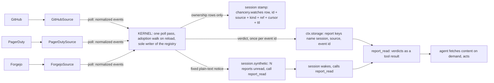

# ADR 20261119: The watcher family: one kernel, source adapters, delivery through the director plugin

- **Status**: Draft
- **Provenance**:
  - Authored: the chancery director, at Nik's request to generalize the watcher design
  - Edited: Nik (asked for a readability rewrite; asked that this record be an ADR, not an implementation plan;
    2026-11-19)
  - Approved: none

## Context

The watcher family grew one source at a time, and each source kept the shape it was born with. Forgejo came first
(PRJ-244, reworked in the forgejo-adapter MCP-connection changes) as one file holding the poll loop, the stamp
machinery, the tools, and the source logic. PagerDuty came second as a class in the same package, sharing the stamp
helpers by parameter; its own comment names the defect: "this same poll-pass/claims/wake shape with no abstraction
between the [sources]". The GitHub watcher plan (2026-11-17) proposed a third source as a separate plugin with copied
helpers.

Three facts changed under that plan while it sat parked:

- New source code is TypeScript (AGENTS.md ruling, 2026-11-19), so the proposed github-watcher.js cannot be built as
  written.
- The director module now ships a pull transport: verdicts stored in `ctx.storage`, a fixed plain-text wake notice, and
  `report_read` as the reader. It exists because the provider drops a user message made only of `<system-reminder>`
  blocks and shows the model the literal text `.`. The family still delivers by push, so a verdict that wakes an idle
  session never reaches the model that wake was for.
- The family has two sources and therefore two writers reading and patching the same stamp subtree; one source's write
  can lose another's.

Parts of the current design work, and this decision keeps them: the projection (PRJ-406), a pure SQLite mirror of the
forge's PR state with every API answer validated on entry; the privacy model, in which notifications carry pointer data
and machine status only and the agent fetches content on demand; baseline-on-register, so a watch created after a fast
pipeline still reports the finished result; the delivered marker written before the send; and self-disable with a named
reason when a source's credentials are missing.

Design order follows the repo convention: OpenCode-native primitives first (session metadata stamps, `ctx.storage`,
`session.synthetic`), thatch's watcher design second, invention last. The one invented piece is the kernel/source split,
and the PagerDuty comment above is the justification for it.

## Decision

One watcher kernel owns everything the sources have in common. Sources are adapters that read their external system and
return events; they never touch stamps and never deliver. The kernel is the only writer of the watch registry.

Ownership stays on the session stamps. A watch follows its session, goes inert with its session's death, and is
re-adopted from durable metadata on every activation and reload. This is the OpenCode-native home for it, and it is what
the family already does.

Delivery bookkeeping moves from the stamps into `ctx.storage`, under a key that names the session, the source, and the
event. The key is the at-most-once guarantee: a verdict is stored once, the record survives reloads and restarts, and
the stamps no longer carry the state two writers could race on.

Delivery goes through the director module's pull transport. The kernel files each verdict into that store and sends one
fixed plain-text wake notice; the session reads verdicts through `report_read` as a tool result. Two rulings make this
the only shape: content another agent wrote reaches a model only as a tool result, and the provider discards
reminder-wrapped mail. The notice carries no watcher prose, so both hold automatically. `mailEnvelope` stays exported
until the last caller converts, then deprecates.

The event a source returns has no free-text field. Its fields are pointer data and machine status, values whose
provenance is the source's API. This is the existing privacy model, made structural: a source author cannot ship a
comment body into a model's context because the type has nowhere to put one. The agent fetches content from the source
when it decides to act.

The family has one tool surface with a source discriminator (`watcher_register/list/forget`); a source does not mint its
own tools.

A watch can be owned by a directory instead of the registering session. At every adoption walk, the kernel binds a
directory-owned watch to that directory's director session: the session running agent `director` with no coordinator
stamp. Build and plan sessions in the same tree never receive watches, and a standing watch survives restarts and
session replacement with no re-registration. With no matching session, the pass logs and skips: CI verdicts are
ephemeral, so undelivered events are dropped, not queued.

The daemon's own alarm log is one such source. The KB compose alarm (2026-11-19) and the consolidation backlog alarm
print to a log file nobody tails, which is how this week's two silent failures stayed silent. A daemon-log adapter turns
those lines into watch events, and its standing watch, owned by the chancery directory, carries them to the directory's
director automatically.

The parts of thatch's watcher design that fit port as concepts: an event taxonomy per source, TTL on non-terminal
watches, command watches as a possible later adapter. Its mechanism does not port; it assumes a different session model.

## Alternatives

Keep growing sources beside each other, sharing helpers by parameter. That is the state the PagerDuty comment names:
every new source re-derives the poll loop, the dedupe, and the delivery, every source adds another writer to the stamp,
and every wake still arrives as `.`.

One plugin per source. It isolates failures furthest, but duplicates config, adoption walks, and stamp subtrees for
sources that share one host, one cadence, and one delivery path. The kernel's per-source isolation gives the same
effect.

Port thatch's watcher system wholesale. Its lifecycle assumes its session model, not ours; the stamp and the adoption
walk already give re-arm and death-as-inert.

## Consequences

- Both existing watchers become adapters: `index.ts` keeps the Forgejo source, its config, and the family's tool wiring;
  `pagerduty.ts` keeps its client and its mail builder. The kernel and the projection are the shared code, and the stamp
  machinery has exactly one writer.
- Adding a source stops being a design exercise: implement the contract and pass the shared contract tests, which cover
  at-most-once delivery, baseline on register, self-disable, TTL, isolation, and privacy for every source.
- The delivery cutover changes what every watcher user sees: wakes become fixed notices, verdicts arrive through
  `report_read`. The system lane times that change.
- The 2026-11-17 GitHub plan's separate-plugin shape and copied helpers are superseded; its event-scope questions move
  with the GitHub adapter work.

## Adoption

The decision is adoptable in behavior-preserving increments: the kernel lands first, and the existing sources move onto
it one at a time, each merge keeping today's behavior. The delivery cutover is the one visible behavior change, and the
system lane times it. The order in which new sources arrive is build planning, not architecture; it lives in the lane's
manifest and moves with operational priority.

## Left for the implementation

The contract's exact method shapes, the daemon-log adapter's cursor mechanics, a per-repo GitHub projection following
the forge_state pattern, command watches, and the TTL default. None of these is an architecture decision; each is judged
when the slice that needs it is planned.
