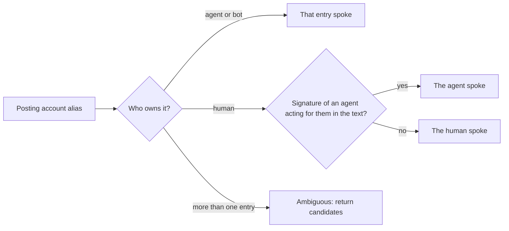

# PRD 20261023: Entity directory

- **Status**: Draft
- **Companion ADRs**: `docs/adr/20261023-entity-directory.md` (the decisions),
  `docs/adr/20261023-forward-compatible-sync.md` (the rollout this depends on)
- **Audience**: the agents that will implement and use it
- **Provenance**:
  - Authored: agent
  - Edited: the operator (design directed through plan review; observations in their own store, sessions on directory
    rows)
  - Approved: none

## Problem

Before an agent writes a review comment, a reply, a chat message, or a ticket comment to or about a specific person, it
should recall what has been learned about how that person, or an agent acting for them, communicates and works, and
adjust its framing to fit. Framing only: the findings, their severity, the evidence, and the ask never change. What is
learned should come from every interaction: their PRs, their reviews, their replies or their agent's, chat, tickets, and
the conventions in their code and docs.

The store has no way to say who an observation is about, so none of this is reliable today. And an account is not a
person: an agent can post from the account of the person it acts for, and what it writes belongs to the agent.

## Requirements

- An entry is a `human`, an `agent`, or a `bot`. An agent acts for exactly one human. Bots (service accounts such as CI
  or dependency bots) can have observations too.
- Entries are found by alias (an account on a service, an email address, a name) and by searching names and handles.
- Who wrote a comment is decided by its text as well as the account that posted it.
- Observations live in the directory, one per row, each about one entry: the entry that wrote or did the thing observed.
  Style and habits, never skill.
- Observations never fold into a project's knowledge base. The knowledge base build reads deliberate memories, and an
  observation is not one. A note about someone that an agent writes as an ordinary memory still folds, the way any
  deliberate memory does.
- Reading a human's observations also returns those of the agents that act for them. Reading an agent's returns only the
  agent's.
- Every directory row records the session that wrote it, the way deliberate memories do.
- Kinds, alias types, and relation verbs are fixed sets in code. Anything else is refused with the valid values listed.
  Tool input schemas are not enforced by the daemon (every handler takes `**_`), so each handler validates its own
  arguments.
- A write naming an unknown alias is refused with name-similar candidates. Nothing creates an entry except an explicit
  create.
- Every machine converges on the same directory, whatever order records arrive in, and sync never stalls on a conflict.
- The repository is public: code, docs, tool descriptions, and instructions use invented examples only.

## Schema

The directory is append-only. A change never edits a row's content: it inserts a row, or sets a one-way `deleted_at` on
an existing one. Applying a synced record is either an insert-if-absent or a set-if-empty, so machines holding the same
rows reach the same state in any order. When two machines set `deleted_at` on the same row, the earlier timestamp is
kept.

Every row carries `session_id`, this machine's registry id for the session that wrote it. The session is the one foreign
key: apply registers it before inserting the row. Every other reference is plain text, because a row can arrive over
sync before the row it points at.

```sql
-- Identity only. kind never changes; a wrong kind is forgotten and recreated.
CREATE TABLE IF NOT EXISTS entities (
    id TEXT PRIMARY KEY,                    -- e{time_ns:x}, generated on the machine that creates it
    kind TEXT NOT NULL,                     -- human | agent | bot
    session_id TEXT NOT NULL REFERENCES session(id),
    created_at TEXT NOT NULL
);

-- One row per forget. Restoring sets deleted_at on the open forget row;
-- forgetting again is a new row. An entry is forgotten while it has a
-- forget row with no deleted_at.
CREATE TABLE IF NOT EXISTS entity_forgets (
    id TEXT PRIMARY KEY,
    entity_id TEXT NOT NULL,
    session_id TEXT NOT NULL REFERENCES session(id),
    created_at TEXT NOT NULL,
    deleted_at TEXT
);

CREATE INDEX IF NOT EXISTS idx_forgets_entity ON entity_forgets(entity_id);

-- The display name is the one field that changes. The newest row wins.
CREATE TABLE IF NOT EXISTS entity_names (
    id TEXT PRIMARY KEY,
    entity_id TEXT NOT NULL,
    display_name TEXT NOT NULL,
    session_id TEXT NOT NULL REFERENCES session(id),
    created_at TEXT NOT NULL
);

CREATE INDEX IF NOT EXISTS idx_names_entity ON entity_names(entity_id, created_at);

-- Typed relationships between entries: subject, verb, object. Ending one
-- sets deleted_at; changing one ends the old row and adds a new one.
CREATE TABLE IF NOT EXISTS entity_relations (
    id TEXT PRIMARY KEY,
    subject_id TEXT NOT NULL,
    verb TEXT NOT NULL,                     -- acts_for | merged_into
    object_id TEXT NOT NULL,
    session_id TEXT NOT NULL REFERENCES session(id),
    created_at TEXT NOT NULL,
    deleted_at TEXT
);

CREATE INDEX IF NOT EXISTS idx_relations_subject ON entity_relations(subject_id, verb);
CREATE INDEX IF NOT EXISTS idx_relations_object ON entity_relations(object_id, verb);

-- One row per alias added. Removing an alias sets deleted_at on that row;
-- adding it again later is a new row.
CREATE TABLE IF NOT EXISTS entity_aliases (
    id TEXT PRIMARY KEY,
    entity_id TEXT NOT NULL,
    type TEXT NOT NULL,                     -- github | slack | email | linear | jira | name | signature
    instance TEXT NOT NULL DEFAULT '',      -- github.com, a Slack team id, a Jira site; '' for email, name, signature
    value TEXT NOT NULL,                    -- normalized per type
    session_id TEXT NOT NULL REFERENCES session(id),
    created_at TEXT NOT NULL,
    deleted_at TEXT
);

-- Deliberately not UNIQUE: two machines can each give one alias to a
-- different entry before they sync, and apply must accept both rather than
-- stall. The tool refuses a taken alias at write time; a collision that
-- arrives over sync shows up as an ambiguous lookup.
CREATE INDEX IF NOT EXISTS idx_alias_lookup ON entity_aliases(type, instance, value);

-- One row per observation, filed under the entry that wrote or did the
-- thing observed. Correcting one adds a new row and ends the old.
CREATE TABLE IF NOT EXISTS entity_observations (
    id TEXT PRIMARY KEY,                    -- o{time_ns:x}
    entity_id TEXT NOT NULL,
    content TEXT NOT NULL,
    session_id TEXT NOT NULL REFERENCES session(id),
    created_at TEXT NOT NULL,
    deleted_at TEXT
);

CREATE INDEX IF NOT EXISTS idx_observations_entity ON entity_observations(entity_id);
```

A removal names the specific row it ends, never the alias value. If machine A removes `jdoe` from an entry while machine
B adds a Slack alias to it, B's change is a new row that never touches the `jdoe` row, so nothing brings the removed
alias back. A removal cannot reach the hub ahead of the row it ends, because a machine can only remove a row it has
received.

### Aliases

An alias is unique on `(type, instance, value)` among current aliases. Per type:

- `github`: the login, lowercased. `instance` is the host, `github.com` by default or an Enterprise server. A login
  freed by a rename can later be claimed by someone else; that is accepted as rare and fixed by removing the alias or
  merging.
- `slack`: the member id, not the display handle, which changes. `instance` is the team id.
- `linear`, `jira`: the user id within the workspace or site named in `instance`.
- `email`: lowercased only. Dots and `+tags` are left alone; folding them would merge addresses that are not the same.
- `name`: never unique. A name lookup returns candidates and never resolves on its own.
- `signature`: agents only, never unique. Matched against a comment's text, not by equality:
  - both sides are case-folded, whitespace is collapsed, and markdown emphasis and quote marks are stripped;
  - quoted lines (starting with `>`) are dropped first, so a person quoting their agent's comment is not attributed to
    the agent;
  - the signature has to appear in the opening lines of what is left;
  - an agent whose wording varies gets one signature alias per variant;
  - a miss falls through to the agent-written hint, never to a near match.

### Relations

Verbs are a fixed set with rules enforced at write time:

- `acts_for`: the subject is an agent and the object is a human. An agent is created with exactly one; changing it ends
  the old row and adds a new one.
- `merged_into`: subject and object have the same kind, a subject has at most one, and a merge into an entry that is
  itself merged is refused in favor of its final target. Ending the row undoes the merge.

A new verb is a value and its rules, not a schema change.

Two machines can each add a relation the rules would refuse together: two `acts_for` rows for one agent, or two merges
pointing at each other. Materialization keeps the newer row (`created_at`, then id), so every machine agrees, and
lookups report the conflict the way they report an alias collision.

### Materialized state

Three machine-local tables hold the current state of entries, relations, and aliases. The daemon recomputes all three
for the whole directory in the same transaction as every local write and every applied record that touches them.
Whole-directory rather than per-entry: a merge chain makes the set of entries an edit affects open-ended, and
recomputing everything is order-independent by construction. The directory holds people, so it stays small.

- `current_entities`: entries with no open forget row, with their newest name, their current `acts_for`, and the final
  target of any merge chain.
- `current_relations`: relation rows with no `deleted_at`, after conflicts are settled.
- `current_aliases`: alias rows with no `deleted_at` whose entry is current, attributed to the entry's final merge
  target, indexed on `(type, instance, value)`. Aliases that end up under one merged entry are not a collision.

They are derived and never synced, like the vector tables, and are rebuilt from the append-only tables at open when
missing or when their recorded schema version does not match. They hold nothing that differs between machines: a
collision report finds which session, and so which machine, added an alias by reading the alias row itself.

Observations have no materialized table. A read joins them to `current_entities` on the entry each row names and keeps
the open rows whose entry resolves to the one asked about, so a merge gathers observations under its target and a
forgotten entry's drop out. Writing an observation recomputes nothing, which matters because observations will far
outnumber entries.

## Sync

One new record kind, `entity`, with an `op` field:

- `create`, `rename`, `relate`, `alias_add`, `observe`: each carries one new row. Apply inserts keyed on the payload's
  `id`, so a replay inserts nothing.
- `unrelate`, `alias_remove`, `unobserve`, `restore`: each carries a row id and a `deleted_at`.

Every insert carries `session: {machine, tool, conversation_id, project}`, the same shape `agent_memory` records carry.
A registry id is local to each machine, so it never rides the wire; each receiving machine resolves the triple to its
own session row. Removals carry no session: they set `deleted_at` on a row that already records who wrote it, the same
way memory forgets carry none.

`created_at` and `deleted_at` must be exactly `YYYY-MM-DDTHH:MM:SSZ`. Apply orders rows and keeps the earliest
`deleted_at` by comparing these strings, which is chronological only when every stamp has one shape: `14:00:00-04:00`
sorts before `17:00:00Z`, the same instant.

Forgetting an entry uses the existing `forget` kind, with `entities` added to `FORGET_TABLES`. For that table, forget
adds an `entity_forgets` row instead of deleting, and the record carries `session` like an insert, because it adds a
row.

## Tools

ADR 20261110, "Each domain owns its commands under its own prefix", gives the directory its own prefix, `entity_`, added
to `TOOL_PREFIXES`. No `memory_*` tool reaches into the directory.

- `entity_save`: create an entry, rename it, change `acts_for`, add and remove aliases as explicit lists, restore a
  forgotten entry. Never a full replace: an agent resaving from a partial view would silently drop aliases.
- `entity_get`: look up one entry by id or alias, with its observations. With `text`, resolve who wrote it.
- `entity_find`: search names and handles, or list every current entry when given no query. Optional `kind` and
  `alias_type` filters, validated against their fixed sets.
- `entity_merge`: merge one entry into another, or undo a merge.
- `entity_observe`: record one observation about one entry, up to 1,200 characters. With `replaces`, the new observation
  is a correction: it is added and the named one is removed in the same call.
- `entity_forget`: forget an entry or remove an observation, by id.

Every parameter that names an entry (`entity`, `acts_for`, `into`, the lookup in `entity_get`) takes either an id string
or one alias shape, `{"type": ..., "instance": ..., "value": ...}`. `instance` may be omitted for GitHub (default
`github.com`) and for email, name, and signature, which have none. An alias that does not resolve to exactly one current
entry is refused.

### Finding someone by name

The user says "Jane" with no other context. A search matches the start of any word in display names and `name` aliases,
and any part of a handle. Agents are listed with the human they act for.

```json
entity_find {"query": "jane"}

{"status": "ok", "count": 3,
 "results": [
   {"id": "e18f2a01", "kind": "human", "display_name": "Jane Doe",
    "matched": "name: Jane Doe",
    "aliases": ["github:jdoe", "slack:T0123/U04ABC"],
    "agents": [{"id": "e18f2b10", "display_name": "Reviewbot"}],
    "observations": 7},
   {"id": "e18f5c20", "kind": "human", "display_name": "Jane Smith",
    "matched": "name: Jane Smith",
    "aliases": ["email:jsmith@example.com"],
    "agents": [],
    "observations": 1},
   {"id": "e18f2b10", "kind": "agent", "display_name": "Reviewbot",
    "matched": "signature: Reviewbot is thinking on behalf of Jane",
    "acts_for": {"id": "e18f2a01", "display_name": "Jane Doe"},
    "observations": 3}
 ],
 "hint": "A name never resolves on its own. One human matched: use it and say which. Several: ask the user which one. None: say so; do not create an entry from a bare name."}
```

`{"query": "jane", "kind": "human"}` drops Reviewbot; `{"query": "jdo", "alias_type": "github"}` searches GitHub logins
only.

### A review, end to end

An agent reviews a PR from `jdoe`. One thread reply was posted from `jdoe` but written by Jane's review agent.

1. Look up the author. Not found; nothing is created.

   ```json
   entity_get {"alias": {"type": "github", "value": "jdoe"}}
   {"status": "not_found", "candidates": [],
    "hint": "No entry holds github:jdoe. Search by name with entity_find before creating one; if the person is already there, add the alias to that entry."}
   ```

2. Create her.

   ```json
   entity_save {"kind": "human", "display_name": "Jane Doe",
                "add_aliases": [{"type": "github", "value": "jdoe"},
                                {"type": "name", "value": "Jane Doe"}]}
   {"status": "ok", "id": "e18f2a01", "kind": "human", "display_name": "Jane Doe",
    "aliases": [{"id": "a18f2a02", "type": "github", "instance": "github.com", "value": "jdoe"},
                {"id": "a18f2a03", "type": "name", "instance": "", "value": "Jane Doe"}]}
   ```

3. Resolve who wrote the reply. The account resolves to Jane; the text reads as agent-written, so the response carries a
   hint.

   ```json
   entity_get {"alias": {"type": "github", "value": "jdoe"},
               "text": "Reviewbot is thinking on behalf of Jane. The retry loop is intentional..."}
   {"status": "ok", "speaker": {"id": "e18f2a01", "kind": "human", "display_name": "Jane Doe"},
    "matched_signature": null,
    "hint": "The text reads as agent-written (\"on behalf of\"). If an agent wrote it, create it with entity_save: kind agent, acts_for e18f2a01, and its signature as an alias."}
   ```

4. Create the agent.

   ```json
   entity_save {"kind": "agent", "display_name": "Reviewbot", "acts_for": "e18f2a01",
                "add_aliases": [{"type": "signature", "value": "Reviewbot is thinking on behalf of Jane"}]}
   {"status": "ok", "id": "e18f2b10", "kind": "agent", "acts_for": "e18f2a01", ...}
   ```

5. Resolve again. The signature matches.

   ```json
   entity_get {"alias": {"type": "github", "value": "jdoe"}, "text": "Reviewbot is thinking on behalf of Jane. ..."}
   {"status": "ok", "speaker": {"id": "e18f2b10", "kind": "agent", "display_name": "Reviewbot", "acts_for": "e18f2a01"},
    "matched_signature": "Reviewbot is thinking on behalf of Jane"}
   ```

6. Record what the reply taught, under the agent.

   ```json
   entity_observe {"entity": "e18f2b10",
                   "content": "Reviewbot concedes a point once shown the code path, and restates the concession as a numbered list. Dense prose works; no need to soften."}
   {"status": "ok", "id": "o18f2c00", "entity": "e18f2b10"}
   ```

7. Move a note written as a memory before the directory existed. The text goes into an observation, and the memory is
   forgotten, so the note stops folding into the project's knowledge base.

   ```json
   entity_observe {"entity": {"type": "github", "value": "jdoe"},
                   "content": "Jane prefers a heads-up over a defect framing for style nits."}
   {"status": "ok", "id": "o18f2c10", "entity": "e18f2a01"}

   memory_forget {"table": "agent_memory", "id": "m18e0a111"}
   ```

8. Look her up before the next review. Either form returns Jane's observations and Reviewbot's.

   ```json
   entity_get {"id": "e18f2a01"}
   entity_get {"alias": {"type": "github", "value": "jdoe"}}

   {"status": "ok", "id": "e18f2a01", "kind": "human", "display_name": "Jane Doe",
    "agents": [{"id": "e18f2b10", "display_name": "Reviewbot"}],
    "observations": [
      {"id": "o18f2c10", "about": "e18f2a01", "content": "Jane prefers a heads-up over a defect framing...", ...},
      {"id": "o18f2c00", "about": "e18f2b10", "content": "Reviewbot concedes a point once shown...", ...}
    ]}
   ```

9. Correct an observation that turned out wrong.

   ```json
   entity_observe {"entity": "e18f2b10", "replaces": "o18f2c00",
                   "content": "Reviewbot concedes a point once shown the code path. It does not restate the concession."}
   {"status": "ok", "id": "o18f2d00", "entity": "e18f2b10", "replaced": "o18f2c00"}
   ```

10. Merge a duplicate created from her Slack account, and undo it.

    ```json
    entity_merge {"id": "e18f3000", "into": "e18f2a01"}
    {"status": "ok", "merged": "e18f3000", "into": "e18f2a01"}

    entity_merge {"id": "e18f3000", "undo": true}
    {"status": "ok", "unmerged": "e18f3000"}
    ```

### Refusals

Each refusal says what would be valid.

```json
entity_save {"kind": "agent", "display_name": "Reviewbot"}
-> error: "an agent needs acts_for: the id or an alias of the human it acts for"

entity_save {"kind": "person", "display_name": "Jane Doe"}
-> error: "unknown kind 'person'; use one of agent, bot, human"

entity_save {"id": "e18f4000", "add_aliases": [{"type": "github", "value": "jdoe"}]}
-> error: "github:jdoe on github.com already belongs to e18f2a01 (Jane Doe); merge the entries or use a different alias"

entity_observe {"entity": {"type": "github", "value": "jdoe2"}, "content": "..."}
-> error: "no entry holds github:jdoe2; candidates by name: e18f2a01 (Jane Doe). Add the alias with entity_save, or create the entry"
```

## Resolving who spoke



An agent posting from its own account holds that account as its own alias. When no signature matches but the text shows
common agent markers ("on behalf of", "Agent-generated", "generated by"), the response carries a hint naming the calls
to create the agent. The first encounter is a judgment call the tool prompts; after that, attribution is mechanical.

## Collisions

An alias held by two current entries, which can happen only across machines, does not resolve. The lookup returns both
entries with which machine added each alias and when, and names the fix: merge them, or remove the wrong alias. Relation
conflicts are reported the same way.

## Forgetting and restoring

Forgetting an entry adds a forget row. The entry drops out of lookups and search, and its observations drop out with it.
The observation rows stay, so a restore brings them back.

A forgotten entry comes back only through an explicit restore:

- Lookups and search never mention forgotten entries.
- Creating an entry or adding an alias checks every unique alias against forgotten entries as well as current ones. A
  forgotten holder is refused with the restore call offered; `override_confirmation: true` creates the new entry anyway.
- `override_confirmation` only passes a forgotten holder. An alias held by a current entry is refused regardless.
- Name aliases never block, since names are never unique.
- A restore is refused when one of the entry's aliases has since gone to a current entry, and the refusal points at
  merging.

```json
entity_forget {"id": "e18f2a01"}
{"status": "ok", "forgotten": "e18f2a01"}

entity_get {"alias": {"type": "github", "value": "jdoe"}}
{"status": "not_found", "candidates": [], "hint": "No entry holds github:jdoe. ..."}

entity_save {"kind": "human", "display_name": "Jane Doe",
             "add_aliases": [{"type": "github", "value": "jdoe"}]}
-> error: "github:jdoe on github.com belongs to a forgotten entry, e18f2a01 (Jane Doe). Restore it with entity_save {\"id\": \"e18f2a01\", \"restore\": true}. To create a separate entry anyway, repeat this call with \"override_confirmation\": true."

entity_save {"id": "e18f2a01", "restore": true}
{"status": "ok", "id": "e18f2a01", "restored": true}

entity_save {"kind": "human", "display_name": "Jane Doe",
             "add_aliases": [{"type": "github", "value": "jdoe"}],
             "override_confirmation": true}
{"status": "ok", "id": "e18f6000", ...}

entity_save {"id": "e18f4000", "add_aliases": [{"type": "github", "value": "jdoe"}], "override_confirmation": true}
-> error: "override_confirmation only applies when the alias belongs to a forgotten entry; e18f2a01 (Jane Doe) is current. Merge the entries or use a different alias"

entity_save {"id": "e18f2a01", "restore": true}   (after the override gave github:jdoe to e18f6000)
-> error: "restoring e18f2a01 would give github:jdoe to two current entries (also e18f6000). Restore it and merge one into the other, or remove the alias from e18f6000 first"
```

## Instructions for agents

The rules reach agents in two places, both served to every client: `instructions/memory.md` (installed as the Cursor
rule and as an OpenCode instructions file) and the tool descriptions in `TOOLS`. The tool descriptions repeat what
matters at the moment of the call.

New section in `instructions/memory.md`, after "When to write":

```markdown
## People and agents

What you learn about how someone you work with communicates or works goes in the entity directory, one observation per
call to `entity_observe`, under their entry. Style and habits, never skill. Observations stay out of the project
knowledge base; do not write them as memories.

Before recording anything about what someone said or wrote, resolve who actually wrote it:

- Call `entity_get` with the posting account's alias and the text. The account alone does not decide it: an agent can
  post from the account of the person it acts for.
- If the speaker comes back as an agent, the agent wrote it. File the observation under the agent, not the person.
- If the response hints that the text reads as agent-written and no signature matched, look for a fixed line that
  identifies the agent, such as "<Agent> is thinking on behalf of <Name>" or an "Agent-generated" header. If there is
  one, create the agent with `acts_for` set to that person and the line as its `signature` alias, then resolve again.
- If there is no such line and you cannot tell, do not create an agent on a guess. Leave the speaker as the account's
  owner and say in the observation that it may have been agent-written.
- An agent's signature never goes on the person's entry, and the person's account alias never goes on the agent's.

Before writing anything addressed to or about a specific person or agent, look them up with `entity_get`. A person's
entry also returns what is known about agents acting for them. Use it to adjust framing only; it never changes what you
say, only how.
```

Tool description additions:

- `entity_get`: "Pass `text` whenever you have the words someone posted. The account that posted a comment is not
  necessarily who wrote it, and only the text can tell an agent's reply from its person's."
- `entity_save`: "An agent needs `acts_for`, the human it works for. Its identifying line (for example '<Agent> is
  thinking on behalf of <Name>') goes on the agent as a `signature` alias, never on the human."
- `entity_observe`: "File the observation under the entry that actually wrote or did the thing observed. Resolve the
  speaker with `entity_get` first when an agent might have written it. To correct an observation, pass `replaces` with
  its id rather than adding a second one that contradicts it."

The review-pr skill uses the directory at the point of use: resolve the PR author and the speaker of every thread reply
while gathering context (kept out of the blind pass so it does not know whose code it is reading), look up each entry
before drafting, and record framing corrections and reply lessons as observations under whoever actually spoke.

## Rollout

The `entity` kind ships in the same deploy as ADR 20261023-forward-compatible-sync, in order: the hub, then every
client, before any machine writes an entity. That is the last ordered deploy; later kinds can roll out in any order.

## Non-goals

- Free-form tags on memories.
- Judgments of anyone's skill.
- Keying GitHub aliases on numeric user ids.
- A graph database; the relations table covers the one- and two-step queries this needs.

## Success signals

- Looking up a human from any repo's session returns observations about them and their agents.
- A comment posted from a person's account with a stored signature resolves to the agent; without one, to the person.
- An observation applied before its entry has arrived, and an entity record deferred and applied late, both converge to
  the same state as in-order apply.
- A collision created on two machines shows up as an ambiguous lookup on both, and sync keeps running.
- A merge and its undo leave every observation resolving where it did before.
- No observation appears in a project's knowledge base.

## Open items

- How many opening lines a signature may appear in.
- The exact agent markers that trigger the agent-written hint.
- Whether `entity_find` ranks by match quality, observation count, or recency.
